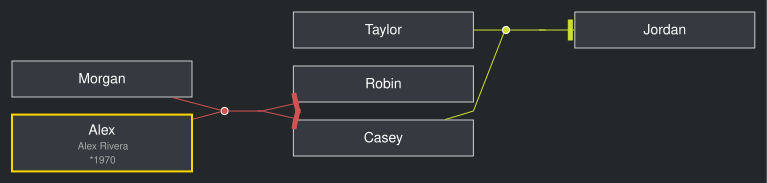
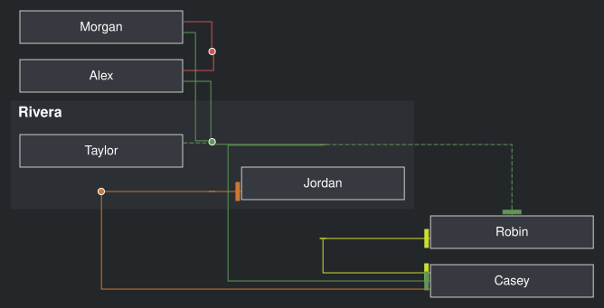
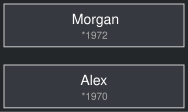

# Schema

V1 is a single family-tree mapping with optional [families](#family),
[people](#person), and [styles](#styles). `{}` is valid. All fields below are
optional. Validation does not insert defaults or coerce values; defaults below
are renderer fallbacks when fields are omitted.

Known fields must have the listed types. Unknown root, family, and person keys
are retained but ignored by the renderer. Observed extra person metadata
`adopted`, `age`, and `nickname` has no rendering effect. Styles apply through
selectors, not through interpreting that metadata.

## Root

| Field           | Expected type                                          | Omission / rendering effect                                                                                                                                         |
| --------------- | ------------------------------------------------------ | ------------------------------------------------------------------------------------------------------------------------------------------------------------------- |
| `schemaVersion` | Numeric literal `1`                                    | Omission or `1` selects v1. Every other value, including string `"1"` and `null`, is rejected. No visual effect.                                                    |
| `families`      | Array of family mappings or `null` entries             | Defaults to no families. Each entry creates a family cluster; `null` behaves as an empty family. See [Family](#family).                                             |
| `people`        | Mapping of string IDs to person mappings or `null`     | Defaults to no explicit person definitions. Each entry renders a person, even without a family connection; `null` behaves as empty metadata. See [Person](#person). |
| `styles`        | Mapping of selector strings to style-property mappings | Defaults to built-in styles. Matching user entries override defaults; see [Styles](#styles).                                                                        |

The root cannot be `null`, an array, or a scalar. Collections themselves cannot
be `null`; only family array entries and people mapping values may be `null`.
Other known fields cannot be `null`, except style-property values. Direct
JavaScript callers may omit optional fields or use `undefined`.

```yaml
schemaVersion: 1
families:
    - parents: [Alex, Morgan]
      children: [Casey, Robin]
    - parents: [Casey, Taylor]
      children: [Jordan]
people:
    Alex:
        name: Alex
        fullname: Alex Rivera
        born: 1970
        links: [https://example.org/alex]
        class: [highlight]
styles:
    ':digraph':
        splines: polyline
    highlight:
        color: gold
        penwidth: 2
```



Rendered from the YAML above. Alex has the gold border, full name and birth year;
people without metadata use their IDs as labels. This example explicitly selects
polyline routing: the default orthogonal routing omits two parent edges for this
layout, even though they are present in the generated DOT.

### Public schemas

`@nicodoggie/kingraph/v1/schemas` exports `FamilyTreeSchema`, `FamilySchema`,
`PersonSchema`, `StylePropertiesSchema`, `StylesSchema`, and
`validateFamilyTree`. Public `FamilyTree`, `Family`, `Person`,
`StyleProperties`, and `Stylesheet` types are inferred from these schemas.

```ts
import {
    FamilyTreeSchema,
    FamilySchema,
    PersonSchema,
    StylePropertiesSchema,
    StylesSchema,
    validateFamilyTree,
} from '@nicodoggie/kingraph/v1/schemas';

const tree = FamilyTreeSchema.parse({
    schemaVersion: 1,
    families: [{ parents: ['Alex'], children: ['Casey'] }],
});
FamilySchema.parse({ children: ['Robin'] });
PersonSchema.parse({ name: 'Alex', born: 1970 });
StylePropertiesSchema.parse({ color: 'gold', penwidth: 2 });
StylesSchema.parse({ highlight: { color: 'gold' } });
validateFamilyTree(tree);
```

The schema-only entry works in both Node and browsers, without importing the
renderer, Graphviz or PNG conversion. Rendering APIs and their public types live
at `@nicodoggie/kingraph/v1`; the package root re-exports that v1 API. Both have
browser export conditions, and the existing `/browser` entry remains available.
Permissive validation retains unknown keys but rejects malformed known fields
such as `parents: "Alex"` or `links: [42]`. It does not resolve IDs against
`people` or infer relationship meanings.

## Family

Each root or nested `families` entry is a family mapping or `null`. All seven
family fields are optional: `{}`, parent-only, and child-only families are valid.
No relationship field is required.

| Field                             | Expected type                              | Omission / rendering effect                                                                                                                            |
| --------------------------------- | ------------------------------------------ | ------------------------------------------------------------------------------------------------------------------------------------------------------ |
| <a id="parents"></a>`parents`     | Array of string person IDs                 | Defaults to `[]`. Connects these people to the shared family union node with `:parent-link`.                                                           |
| <a id="parents2"></a>`parents2`   | Array of string person IDs                 | Defaults to `[]`. Connects these people to that same union with `:parent-link` and `:parent2-link` (dashed by default).                                |
| <a id="children"></a>`children`   | Array of string person IDs                 | Defaults to `[]`. Connects the shared children junction to these people with `:child-link`.                                                            |
| <a id="children2"></a>`children2` | Array of string person IDs                 | Defaults to `[]`. Uses the same children junction with `:child-link` and `:child2-link` (dashed by default).                                           |
| <a id="house"></a>`house`         | String                                     | No visible group decoration by default. A nonempty value adds a bold group label and applies `:house`, making the cluster visible with default styles. |
| `links`                           | Array of strings                           | No link by default. Only the first entry supplies the house label's `labelhref`, and only when `house` is nonempty.                                    |
| <a id="families"></a>`families`   | Array of family mappings or `null` entries | Defaults to `[]`. Nests family clusters inside this family. Nested entries are traversed in reverse array order.                                       |

Person IDs are references, not inline objects. They need not appear in `people`:
Graphviz creates implicit nodes for referenced IDs, showing their IDs with global
node defaults. A `people` entry supplies explicit metadata. Use string IDs (quote
numeric-looking YAML IDs in relationship lists).

Every family has an invisible cluster by default. A nonempty `house` applies
visible house styling to that cluster, including nested families; nesting alone
does not draw a visible box. Styles can override this appearance.

```yaml
families:
    # Parent-only family
    - parents: [Alex, Morgan]
    # Children with no listed parents
    - children: [Casey, Robin]
    # A visible group containing another family
    - house: Rivera
      links: [https://example.org/rivera]
      parents: [Alex, Morgan]
      parents2: [Taylor]
      children: [Casey]
      children2: [Robin]
      families:
          - parents: [Casey]
            children: [Jordan]
```



The same people can occur in several family entries. Dashed connections are
the default secondary-link style, not a declaration of adoption or step-parenthood.

### Secondary-link ambiguity

`parents2` and `children2` select alternate edge styles. They do not encode
biological, adoptive, foster, or step relationships. A `parents2` person connects
to the shared family union, not to one particular child. Both child lists connect
to the shared children junction. With parents and children present, an edge joins
the union to that junction. Parent-only and child-only families create only the
relevant junction. Use grouping and accompanying prose to explain intended
relationships. Direct sibling-to-sibling edges are disabled.

## Person

`people` maps each ID to optional metadata. A `null` value acts as `{}` and uses
the ID as its label. All thirteen person fields are optional.

| Field                           | Expected type             | Omission / rendering effect                                                                                                                                                        |
| ------------------------------- | ------------------------- | ---------------------------------------------------------------------------------------------------------------------------------------------------------------------------------- |
| <a id="name"></a>`name`         | String                    | First choice for the rich label's main name; falls back to `display`, then the ID. A nonempty value activates the rich label.                                                      |
| `display`                       | String                    | Second choice for the main name **only if another field activates the rich label**. Alone it leaves the plain ID label.                                                            |
| <a id="fullname"></a>`fullname` | String                    | A nonempty value activates the rich label and adds a smaller gray second line. No line by default.                                                                                 |
| `first_name`                    | String                    | Tooltip only. Concatenated directly with `last_name`, without an inserted space. Omission contributes an empty string.                                                             |
| `last_name`                     | String                    | Tooltip only. Concatenated directly after `first_name`; omission contributes an empty string.                                                                                      |
| `gender`                        | String                    | A nonempty value activates the rich label. Only case-insensitive `f` and `m` append `♀` and `♂`, respectively. Other strings append no symbol; omission adds none.                 |
| `born`                          | `Date`, string, or number | The date adapter supplies `*year` for the lifespan and a `Born` tooltip date. Unsupported fragments are omitted. See [Dated values](#dated-values).                                |
| `died`                          | `Date`, string, or number | The date adapter supplies `†year` and a death tooltip date. With both formatted years, the label is `*year — †year`. Omission adds neither.                                        |
| `created_at`                    | `Date`, string, or number | The date adapter supplies an `Added` tooltip date only; the default is `MM/DD/YYYY`. No addition by default.                                                                       |
| <a id="picture"></a>`picture`   | String                    | A nonempty value activates the rich label and adds an HTML-label image row above the name with `scale='true'`. No image by default. See [Picture limitation](#picture-limitation). |
| <a id="links"></a>`links`       | Array of strings          | No link by default. Only the first entry becomes the person's `href`; later entries are ignored. SVG links are usable inline, not in an image element.                             |
| <a id="class"></a>`class`       | Array of strings          | Defaults to `[]`. Selects matching stylesheet entries for the explicit person node. Stylesheet order determines precedence.                                                        |
| `comment`                       | String                    | Tooltip only. A nonempty value is sliced to its first 50 JavaScript string code units and always followed by `...`, even when shorter than 50. No comment by default.              |

A rich label is the HTML table activated by a nonempty `name`, `fullname`,
`gender`, `picture`, formatted lifespan or adapter-produced age text. `display`,
first/last names, `created_at`, links, classes, and comments alone do not activate
it. Numeric date `0` is present and can produce date output; it is not omitted
as falsy. The plain label is the ID. Custom styles can override generated labels
and links, including the label containing generated age/date rows.

```yaml
people:
    Alex:
        name: Alex
        display: A. Rivera # name takes precedence
        fullname: Alex Rivera
        first_name: 'Alex ' # include the separator yourself
        last_name: Rivera
        gender: F
        born: 1970
        died: '2020-02-03'
        created_at: 2024-01-02
        comment: Example record
        picture: portraits/alex.png
        links: [https://example.org/alex]
        class: [highlight]
```

This example includes a local picture path, so it needs native Graphviz and an
existing image file. It is not previewed here; see [Picture limitation](#picture-limitation).

### Dated values

`born`, `died`, and `created_at` accept JavaScript `Date` objects, strings, or
numbers without schema coercion. For birth/death values, exactly four decimal
digits (string `"1970"` or number `1970`) are treated as a year in both label and
tooltip. Other birth/death values use `new Date(value)`: labels use
`getUTCFullYear()`, and tooltip dates use the `en-US` locale with two-digit
month/day, numeric year, and UTC timezone. Non-four-digit numbers retain
JavaScript's milliseconds-since-epoch behavior; other strings retain JavaScript
date parsing behavior. Accepted strings are not a guarantee of a meaningful date;
the default date adapter omits unparseable/empty values instead of emitting
`NaN` or `Invalid Date`. This omission and rendering numeric zero as a present
value are intentional corrections to the earlier truthiness-based formatter.

`created_at` always uses the full tooltip date conversion, with no four-digit
year shortcut. Use an unambiguous date string or `Date` for a calendar date.
Numbers must be finite, and `Date` objects must represent valid dates. Strings
remain permissive; validation does not impose a date-string format.

### Date and age adapters

Adapters are runtime configuration, not extra v1 document fields. `GraphRenderOptions`
contains optional `dateAdapter`, `ageAdapter` and `asOf`. The same object works
with `renderDot`, Node/browser `render`, the Vite plugin and the CLI's explicit
JavaScript config default export. `asOf(value)` returns an options fragment for
ordinary object-spread composition, with no global state or implicit clock.
The helper and adapter types/defaults are available from the root, `/v1` and
`/browser` entries; Node-specific config loading is not part of those imports.

`DateValue` is the existing `Date | string | number` union. Both DateAdapter
methods return `string | undefined`:

- `formatYear(value, context)` supplies the value after `*` or `†` in a label.
- `formatDate(value, context)` supplies a Born/Died/Added tooltip date.

The context contains readonly `id`, `person`, `tree` and the `field` name
(`born`, `died` or `created_at`). Values reach the adapter without date coercion
by Kingraph. YAML timestamp parsing has already happened, so quote values when
your calendar requires the original string. Unknown person/tree metadata remains
available. `created_at` uses only formatDate. Undefined or empty output omits
that fragment and its punctuation; there is no fallback to another calendar.

An AgeAdapter receives `{ id, person, tree, asOf }` and returns complete age text
or undefined/empty text. The renderer calls it once per explicit person record
and reuses its result in a small label row after the lifespan and a tooltip line.
It can produce age text without born/died and interpret custom lifecycle metadata.
There are no callbacks for implicit Graphviz-only person references absent from
`people`, and metadata named `age` or `lifeHistory` has no automatic semantics.

The exported defaultAgeAdapter uses conventional Gregorian UTC dates, independently
of dateAdapter. Choosing a custom date formatter does **not** change that arithmetic.
Custom-calendar applications supply both policies and may share their own calendar
implementation between them. No adapters mutate the document, and readonly
callback types are not a runtime sandbox or deep freeze.

Default age policy:

- No configured ageAdapter means no age display. Neither asOf nor its helper
  enables age output alone.
- Exact age requires day precision: a valid Date, a non-four-digit numeric epoch
  timestamp, a valid ISO date, or an ISO timestamp with an explicit UTC/offset
  designator. Four-digit numeric/string years do not imply January 1. Unsupported
  strings and impossible ISO calendar dates do not produce an exact age.
- A living person needs explicit asOf; there is no implicit today. Without asOf,
  known birth/death dates can produce age at death.
- With asOf, stop at death if death is on/before the reference; otherwise use the
  reference. A known but imprecise death prevents an exact age rather than silently
  treating the person as living. Missing/imprecise birth or a reference before
  birth also produces no age.
- Count completed years, with a February 29 birthday advancing on March 1 in a
  non-leap year. Age zero is meaningful. Text is `Age: N` or `Age at death: N`.

Adapters must be synchronous. Non-string results (other than undefined), including
Promises, fail rendering. Callback errors retain their cause and identify the
person/operation. Returned text is encoded for HTML labels and DOT tooltips; it
is not a raw-markup hook or a sanitizer for other trusted authoring fields.

See [shared configuration and CLI usage](../README.md#dates-ages-and-shared-configuration)
for examples. The CLI loads only an explicitly supplied trusted local config
module; it never discovers executable configuration in YAML. `--as-of` overrides
config.asOf unchanged, and `--age` selects the default policy only when no custom
policy is configured. Vite imports configuration through its normal config module
and produces an SVG snapshot at transformation time, not a live age display.

### Picture limitation

WASM Graphviz does not automatically load local `picture` files. Emit DOT and
run native Graphviz `dot` with access to the referenced paths. Encoding the
resulting SVG as PNG does not fix image loading at the graph-layout stage. A
picture string is a reference in DOT, not an instruction for kingraph to read
or embed the file.

## Styles

`styles` is an open-ended mapping from selector strings to Graphviz attribute
mappings. Each attribute value must be a string, finite number, boolean, `null`, or
(for JavaScript callers) `undefined`. Arrays and objects are not attribute
values. Attribute names are open-ended: for example, `color`, `fillcolor`,
`fontcolor`, `fontsize`, `penwidth`, `shape`, `label`, `href`, and `rankdir` are
passed to Graphviz. Interpretation depends on the target element.

Strings are JSON-quoted in DOT unless they match `^<.*>$`, in which case they are
emitted verbatim as HTML-like values. Numbers and booleans are emitted as scalars.
`null` and `undefined` suppress an attribute, including an earlier default; they
do not emit the text `null` or `undefined`.

### Built-in selectors and defaults

These are all fourteen default stylesheet entries, in insertion order. Person
classes may also match these exact keys; a leading colon is a naming convention,
not a CSS selector engine.

| Selector             | Applied to                                                          | Default attributes                                                                                                                                      |
| -------------------- | ------------------------------------------------------------------- | ------------------------------------------------------------------------------------------------------------------------------------------------------- |
| `:bgcolor`           | Root graph background                                               | `bgcolor: '#23272A'`                                                                                                                                    |
| `:edge`              | Global edge defaults                                                | `dir: none`, `color: '#cccccc'`                                                                                                                         |
| `:house`             | Family cluster with nonempty `house`                                | `style: filled`, `color: '#2C2F33'`, `labeljust: l`, `fontname: 'Helvetica, Arial, sans-serif'`, `fontcolor: white`, `fontsize: 16`, `margin: 10`       |
| `:house-2`           | Unused by automatic family rendering                                | `color: '#ffffff'`                                                                                                                                      |
| `:family`            | Every family cluster                                                | `label: ''`, `style: invis`, `margin: 0`                                                                                                                |
| `:node`              | Global node defaults, including implicit people and junctions       | `shape: box`, `style: filled`, `fontname: 'Helvetica, Arial, sans-serif'`, `fontcolor: white`, `width: 2.5`, `fillcolor: '#36393f'`, `color: '#cccccc'` |
| `:digraph`           | Root graph layout                                                   | `rankdir: LR`, `ranksep: 0.4`, `splines: ortho`                                                                                                         |
| `:union`             | Shared parent junction when either parent list is nonempty          | `shape: circle`, `style: filled`, `penwidth: 1`, `color: white`, `label: ''`, `height: 0.1`, `width: 0.1`                                               |
| `:children`          | Shared children junction when either child list is nonempty         | `shape: box`, `style: filled`, `label: ''`, `height: 0.005`, `penwidth: 0`, `width: 0.1`                                                                |
| `:parent-link`       | Both parent-to-union edge kinds and union-to-children junction edge | `weight: 2`                                                                                                                                             |
| `:parent2-link`      | Additional style for `parents2` edges                               | `style: dashed`, `penwidth: 1`, `weight: 1`                                                                                                             |
| `:parent-child-link` | Additional style for union-to-children junction edge                | `weight: 3`                                                                                                                                             |
| `:child-link`        | Both children-junction-to-person edge kinds                         | `dir: forward`, `arrowhead: tee`, `arrowsize: 2`, `weight: 2`                                                                                           |
| `:child2-link`       | Additional style for `children2` edges                              | `style: dashed`, `penwidth: 1`, `weight: 1`                                                                                                             |

There is no active sibling-link selector application. `:house-2` is defined but
never automatically selected. Arbitrary custom selectors apply only when listed
in a person's `class`; unknown selectors do not automatically target families,
metadata, IDs, or HTML elements.

### Precedence

Within each style application, the renderer merges:

1. Generated initial attributes (person label/first link, house label/first link,
   or the family's automatically assigned junction/edge color).
2. Matching built-in stylesheet entries, in insertion order.
3. Matching document `styles` entries, in insertion order.
4. Internal final overrides (supported by the style helper; current graph
   rendering does not supply these).

Later values replace earlier ones, including suppression with `null` or
`undefined`. The order of names in `class` does **not** affect the result. For
JavaScript objects, this follows `Object.entries` order, so integer-like keys
enumerate before other string keys. There is no CSS specificity or inheritance
engine. Graphviz supplies global node/edge defaults where individual DOT
statements do not override them.

Family and house styling are separate statements: `:family` first, then `:house`
if present. Similarly, background styling precedes `:digraph`. Later statements
can replace earlier attributes on the same Graphviz object. Junction and
relationship colors otherwise come from a cycling family palette, restarted for
each render; matching styles can override them.

```yaml
people:
    Alex:
        name: Alex
        class: [highlight, muted]
styles:
    ':digraph':
        rankdir: TB
    ':parent2-link':
        style: dotted
    highlight:
        color: gold
        penwidth: 2
    muted:
        color: gray # wins even if class order is reversed
        href: null # suppresses the generated first link if present
```


`muted` wins over `highlight` for the border color; `highlight` still supplies
the thicker border. The parent-link style has no effect in this person-only example.

## YAML tags

The loader accepts one YAML document using the YAML core schema plus timestamp
and merge tags. Unquoted timestamps such as `1970-01-02` become `Date` objects;
quoted dates remain strings. Anchors, aliases, and `<<` merges reuse metadata:

```yaml
people:
    Alex: &record
        born: 1970-01-02
        class: [highlight]
    Morgan:
        <<: *record
        born: '1972-03-04'
```



Morgan inherits the anchored metadata and overrides the birth date. Both the
timestamp and quoted date produce year labels; the unknown `highlight` class
adds no style because this example has no matching stylesheet entry.

Core scalar types still matter: `born: 1970` is numeric, and relationship IDs must
be strings. Empty and comment-only input produce an empty mapping/graph. Explicit
`null`, multiple documents, malformed YAML, and invalid known field types are
rejected. The loader preserves parser diagnostics and the supplied filename. It
does not enable executable YAML tags.

## Trusted authoring boundary

Family data, links, and Graphviz style/HTML-label values are trusted authoring
input. Shape validation is not sanitization: labels, pictures, tooltip text, and
arbitrary Graphviz attributes do not become safe merely by passing the schema.
Use an appropriate sanitization policy before injecting untrusted rendered SVG
into a page.

This reference follows [validation definitions](../src/v1/schemas.ts), [types](../src/types.ts),
[graph rendering](../src/render_graph.ts), [style application](../src/apply_style.ts),
[default styles](../src/defaults/styles.ts), and [YAML loading](../src/yaml.ts).
Existing [graph regressions](../src/render_graph.test.ts),
[style tests](../src/apply_style.test.ts), [YAML tests](../tests/yaml.test.ts), and
[render tests](../tests/render.test.ts) cover corresponding legacy behavior.
